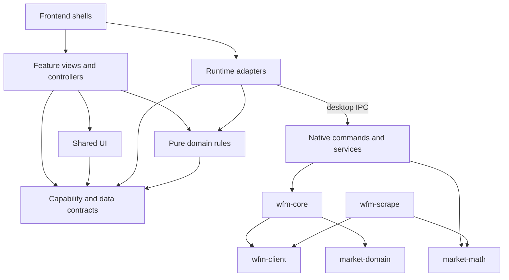

# Architecture and ownership

TennoWorth has three runtime surfaces: a public hosted site, an installed
Windows/Linux desktop app, and its reward overlay. The desktop owns account
operations. A separate host pipeline publishes static market data. There is
no user-account backend and the site never receives inventory.

## Repository map

```text
frontend/
  src/
    main.ts                  runtime selection and dynamic entry loading
    shells/                  desktop and hosted composition; shared shell CSS
    features/                inventory, selling, orders, relics, rivens,
                             market-context, watches, ledger, presence,
                             routines, community, settings
    domain/                  deterministic calculations and resolution
    contracts/               wire shapes, capabilities, errors, state interfaces
    adapters/                Tauri IPC, same-origin loading, persistence
    ui/                      shared visual primitives and capability context
    dev/                     sample transport, styleguide, architecture gates
  admin.html                 separate private dashboard entry (dist-admin)
  src/admin/                 box status, scheduled-job requests, announcements
  public/                    published market/catalog data and static assets
  tests/browser/             styled runtime and visual regression checks
rust/
  tennoworth-desktop/src/
    shell/                   startup, tray, updates, probes
    commands/                IPC entry points and input validation
    services/                inventory state, automatic scan, watches, trades,
                             notifications, WFM status, usage and price reports
    persistence/             schema, record types, table operations, key storage
    game_events.rs           EE.log lines published to whoever subscribes
    vision/
      capture/               platform frame acquisition
      frame.rs, ocr.rs       crop and encode, Tesseract worker, TSV lines
    overlay/                 in-game reward feature
      recognition/           reward layout, matching, result assembly
      presentation/          native windows and Wayland presentation
      lifecycle.rs           capture exclusion and current-result identity
  wfm-core/src/
    acquisition/             process scan and DE inventory acquisition
    trading/                 authentication, catalog, orders, plans, recovery
  wfm-scrape/src/
    ingest/                  upstream transport and source-specific adapters
    pipeline/                build orchestration, root discovery, publication
  market-domain/             inventory, scoring, advisor and planning decisions
  market-domain-wasm/        market-domain for the browser desktop preview (wasm32)
  market-math/               pure shared heuristics
  wfm-client/                shared request policy and transport primitives
  tennoworth-announcements/  pure curated announcement feed contract
  tennoworth-publisher/      private publisher API, SQLite history and feed export
  tennoworth-usage/          opt-in installation-count service
  tennoworth-reports/        opt-in anonymous price-report service
scripts/                     release, CSP, probe and deployment checks
tests/fixtures/             shared parity and pipeline inputs/expectations
deploy/                      live-data refresh and deployment operations
```

## Runtime shape

Three runtime surfaces share one codebase: a public hosted site, an installed
Windows/Linux desktop app, and the in-game reward overlay. Host inventory is
acquired by scanning the running game process; the hosted surface never sees it.

```
┌─ Warframe game ──────────────────────────────────┐
│   /proc/<pid>/mem  or  ReadProcessMemory         │
└────────────────────────┬─────────────────────────┘
                         │ scrape accountId+nonce
                         ▼
        ┌── desktop app (tennoworth-desktop, Tauri) ──┐
        │  same-origin webview (the SPA)              │
        │  scan_inventory → wfm-core → IPC            │
        │  wfm_login → wfm-jwt.enc (AES, Rust-side)   │
        │  listing / orders → wfm-core → WFM          │
        └────────────────────────┬────────────────────┘
                                 │
                 ┌───────────────┴──────────────────┐
                 ▼                                 ▼
       ┌── informational site (frontend/) ──┐    market.json
       │  market browse + desktop showcase    │    (published by the host
       │  no accounts, no files, no scan      │     pipeline on a schedule)
       └──────────────────────────────────────┘
                            ▲
                            │ GET market.json
              ┌─────────────┴────────────────────────────┐
              │  wfm-scrape scrape  (Rust)               │
              │  → CSV → wfm-scrape build                │
              └──────────────────────────────────────────┘
```

The desktop app is the only interactive product. The standalone companion CLI
(`wfm-fetch-inventory` with `fetch`/`login`/`serve`) was removed on 2026-08-02,
and the dormant advisor command and implementation were removed after it. The
hosted site is informational only - no accounts, no file access, no scan - and
`market.json` plus `wfstat-catalog.json` are the artifacts it consumes.

## CI inventory

`.github/workflows/` holds the release and verification workflows:
`release-desktop` (manual dispatch bound to an approved commit; creates the
immutable `desktop-v*` tag during publication), `build-web`,
`build-usage`, `build-reports`, the manual `build-publisher`, `audit`, `ui-smoke`, the weekly
`republish-rolling` (which re-dispatches `build-web`, `build-usage` and
`build-reports`), and the on-demand
`ocr-windows-test` and `publish-wfm-policy`. Shared composite actions live in
`.github/actions/`: `setup-rust`, `setup-windows-ocr`, `stage-tessdata` and
`publish-rolling-release`, which the workflows above call into. The host-only scrape pipeline has no workflow: it is
deployed directly by
[`scripts/deploy-scrape-host.sh`](../scripts/deploy-scrape-host.sh), which is
its only installer.

Cache policy, trigger paths and the ruleset configuration are owned elsewhere:
see [rust-toolkit-2026-lessons.md](rust-toolkit-2026-lessons.md) for the CI
cache measurements and [github-rulesets/](github-rulesets/) for the applied
repository rulesets.

## Dependency direction



Shells choose implementations and provide desktop services through Svelte
context. Features consume typed capabilities; they do not import concrete
adapters. Pure domain rules receive their inputs, including timestamps, instead
of reading storage, clocks, the network, or UI state. Contracts can reference
shared domain types without creating runtime dependencies.

The hosted adapter exposes public market/history loading only. It does not
pretend to support scanning, authentication, or orders through no-op methods.
Desktop services and the standalone overlay are dynamically loaded. Overlay
document styles are surface-scoped so they cannot disable hosted-page scrolling.

`frontend/src/dev/architecture.test.ts` checks static imports and re-exports in
both component script blocks, direct feature/adapter separation, pure-domain
runtime access, hosted transitive imports, and the ban on component type-check
suppression. Type-only edges constrain ownership but do not create runtime
cycles. Svelte diagnostics run separately. This bounded gate does not establish
runtime lifecycle correctness or inspect arbitrary dynamic imports; behavior
and browser tests cover those concerns.

The native module gate parses absolute `crate::` imports, grouped re-exports,
calls and type paths. Services cannot depend on shell or command adapters or
on an in-game feature, persistence cannot depend on those adapters or services,
and shell code calls services directly. In-game features such as `overlay/` sit
beside the adapters: they may use services, persistence and `game_events`, but
not commands or shell. They hear the game through `game_events`, which the
EE.log tailer publishes to and startup subscribes them on, and see it through
`vision/`, which captures the window and recognizes text. Neither imports a
feature. Test-only modules are excluded without hiding production
items later in the file. Relative `super::` paths and macro-generated paths
remain outside this source gate; it is not a compiler dependency graph. Startup
registers command paths inside `tauri::generate_handler!`; that composition is
permitted and does not call command adapters from shell behavior.

## Feature state and composition

The desktop shell composes views and navigation. Inventory acquisition/loading,
listing authentication and interrupted-plan recovery, and persisted filter
preferences live in their respective feature controllers. Dependencies are
injected so failures and overlapping operations can be exercised without
native IPC. Other feature panels retain local state close to their views;
there is no new all-purpose application store.

Shared UI belongs in `ui/` only when multiple features need the same visual
contract. Domain calculations do not belong in a component or generic utility
bag. Transport helpers belong in adapters, even when several features use them.
`data-shell` preserves the ownership of extracted shell styles; do not add it
to feature internals to work around styling boundaries. The
[design system](design-system.md) specifies tokens and composition patterns.

## Native responsibilities

The executable entry delegates to `shell/`. Commands remain the IPC boundary;
services coordinate background work and shared state. Sign-in handlers and the
access-status publisher live in `commands/auth.rs`; `main.rs` supplies that
publisher to startup. The shared `command_error` contract is independent of
both adapters and services. Persistence owns the
SQLite connection, migration SQL, record formats, and operations grouped by
table family. Moving an operation does not change its transaction semantics.

Overlay capture selects a Windows, X11, or unsupported backend at compile time.
Recognition owns Tesseract and item matching. Presentation owns window behavior,
including Wayland-specific rendering. Lifecycle state keeps capture exclusion
separate from the identity of the currently displayed result: finishing a
capture must not implicitly clear or replace that identity.

`wfm-core` stays usable without terminal prompts or a Tauri dependency. Its
acquisition and trading modules share narrowly named HTTP, identity, path, and
time helpers. `wfm-client` shares transport primitives, not an abstraction that
combines anonymous scraping with authenticated order mutation. `market-math`
has no I/O or clock dependency. `market-domain` isolates decision contracts and computations from both Tauri and the network
core, so shared fixtures and contract generation can run without the GUI stack.

That is why `wfm-core` depends on `market-domain` rather than the reverse, and
only where a transport response has to become a typed contract. The
market's own-orders response is decoded once, in `wfm-core::trading::orders`,
into the vendor-neutral `market-domain::orders` types; a response it cannot read
whole is refused as a whole rather than partly reconciled. Listing reconciliation refuses any undecodable row. Trade auto-close uses the
same decoder per row, logs refused rows, and leaves them untouched while
adjusting independently decoded sell orders. Both paths use the catalogue
identity and never invent a quantity.

## Data and failure boundaries

The pipeline ingests upstream data, validates and builds the snapshot, then
publishes the resolver catalog before the market file. CSV is intermediate
input; `market.json` and `wfstat-catalog.json` are the consumer artifacts.
Freshness is attached to the evidence actually fetched. Unavailable, malformed,
unchanged, and authoritative-empty inputs are distinct outcomes.

Hosted data comes from the same origin. Desktop network access stays in Rust;
the webview uses capabilities. JWTs and game session secrets remain on the
native side and must not enter logs. Listing plans persist before the first
mutation and after each item so interrupted batches remain recoverable.

This reorganization preserves IPC command names, database migrations, stored
keys, encrypted envelopes, and published data shapes. Tests must consume the
current implementation, including freshly built binaries where applicable.
Shared cross-language behavior uses fixtures under `tests/fixtures/`.

Reviewed listing batches write an uncertain marker to the pending-plan file
before each market mutation, then write the observed result. The desktop holds
the account mutation guard through journal cleanup. A failed result write
leaves the journal for recovery; finished records can retry cleanup without
contacting the market. Only an absent journal permits a new batch, and an
explicit discard removes a saved record.

## Structural choices and remaining limits

The old single application component mixed runtime selection, feature state,
and presentation. Separate shells and feature controllers make those decisions
explicit. Generic `lib/` and native utility buckets hid ownership; named domain,
adapter, service, and persistence modules replace them. The dormant advisor
command and its unused implementation were removed instead of carrying an
unreachable integration surface.

A folder split alone cannot prevent coordination bugs. Preserve tests for
concurrent scans, failed authentication, interrupted listing recovery, stale
results, and error states whenever ownership changes. Browser previews cannot
certify native capture; Windows and Linux runtime checks remain separate.

The root rename affects deployment paths as well as imports. The installed
puller refuses an unattended layout transition and retains live data during an
explicit migration. Follow [repository-layout-transition.md](repository-layout-transition.md)
for promotion and rollback; a source merge is not permission to migrate a host.

See [CONTRIBUTING.md](../CONTRIBUTING.md) for contribution tiers and executable
setup/check commands.

## Native decision boundary

Desktop inventory normalization, sell-row facts, Trade Session selection,
calendar advice, Baro stock value and relic/set/ducat/build plans run through `evaluate_domain`.
The registry in `rust/market-domain/src/dispatch.rs` defines a tagged request and
matching response together. The command computes on a blocking worker and never
executes orders; existing listing validation, account state and recovery remain
the authority for mutations.

Frontend adapters serialize Maps and optional fields explicitly. Feature
controllers guard response generations, clear obsolete evidence, expose pending
or failed calculations, and preserve local editing state. UI filtering stays
synchronous over native facts. Market-only browsing keeps fixture-gated
TypeScript sell-priority scoring and history; these are not production desktop
fallbacks when native computation fails. The `?preview-desktop` development host
has no Tauri runtime, so its `evaluate_domain` runs `market-domain-wasm`: the same
`DomainRequest::execute`, compiled to wasm32 by `scripts/build-domain-wasm.ts`
and loaded by `frontend/src/dev/domain-wasm.ts`. The preview therefore shows
native results and there is no TypeScript copy of the planners to keep in step.
The dev server alone grants the page `'wasm-unsafe-eval'`; the shipped CSP
copies do not.

`frontend/src/contracts/generated/` contains Rust-derived declarations. The
ordinary Rust tests compare them against current types. To update intentionally:

```sh
cd rust
TENNOWORTH_UPDATE_BINDINGS=1 cargo test -p market-domain domain_bindings_match_rust
TENNOWORTH_UPDATE_BINDINGS=1 cargo test -p tennoworth-desktop desktop_bindings_match_rust
```

The desktop binding pilot covers command errors, WFM access status, watch
notification payloads, automatic-scan settings, trade presence settings and
status, account orders, the app icon colours and outcome, and event names. Existing commands outside that pilot keep
their current adapters; all newly migrated calculations use the generated
request/response registry. Generation preserves serialized optionality and field
names; it does not replace input validation. IPC uses JSON numbers, so large
integer inputs are bounded rather than represented as JavaScript bigint.

The real desktop smoke probe exercises all domain operations against shared
fixtures before completing its existing persistence/authentication checks. A
successful browser preview proves rendering and interaction behavior; it does
not establish that native IPC registration or serialization works.

## Private announcement publishing

The private dashboard is independently built from `frontend/admin.html` into
`dist-admin`; hosted and desktop bundles exclude it. It shares presentation
patterns and feed validation, with a same-origin HTTP capability for publishing.
Its host-only publisher does not depend on the desktop shell. Cloudflare Access
protects the dashboard hostname; the API verifies RS256 identity tokens against
the configured issuer, audience and publisher identities. Mutation requests also
require the configured dashboard Origin. User clients only read the public feed.

SQLite stores saved drafts, published content, revision history and idempotency
keys. A seed feed creates that state on first start and is not read again.
Saves never change the public feed. Publish and withdraw validate a complete
new feed with a strictly advancing timestamp, then export atomically. Pending
exports survive restart; failures leave the previous file available and are
visible in dashboard state. The database and export directory are independent
of web build output. A daily timer writes a consistent `VACUUM INTO` snapshot
beside the state and keeps the newest 30, so host backups never copy a database
mid-write. Caddy's optional feed-root setting switches the existing
`/announcements.json` route to that directory once the publisher has written
its first export there; a missing
configured export returns an error instead of falling back to bundled content.

The dashboard opens on a read-only box status page. The publisher assembles it
on request from `systemctl show`, the loopback health probes, the readiness
report, the alert log and the snapshot directory; a source it cannot read is
listed as a problem instead of failing the page. The readiness report directory
belongs to group `tennoworth-publisher` (set once at install; tmpfiles cannot
manage it below the `wfm`-owned `/srv/wfm/data`). The same page can start a
fixed list of scheduled jobs early (`ops::JOBS`). The publisher never runs
them: it writes a request file into that job's own directory under
`/srv/wfm/jobs`, and a root-owned `tennoworth-job-<id>.path` unit watching only
that directory starts the job's existing service, which systemd does not start
twice. Requests carry only the job name, need the dashboard Origin, are refused
while the job runs or within its pacing window, and are recorded with the
signed-in identity. Deploys, releases and restores are not jobs.

A separately named debug-only publisher supports local browser verification.
The production binary always requires Access configuration, and release builds
reject the development feature. Deployment templates are source examples;
activating the authenticated hostname, service and public-feed route requires
reviewed host configuration.
